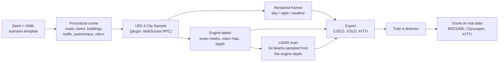
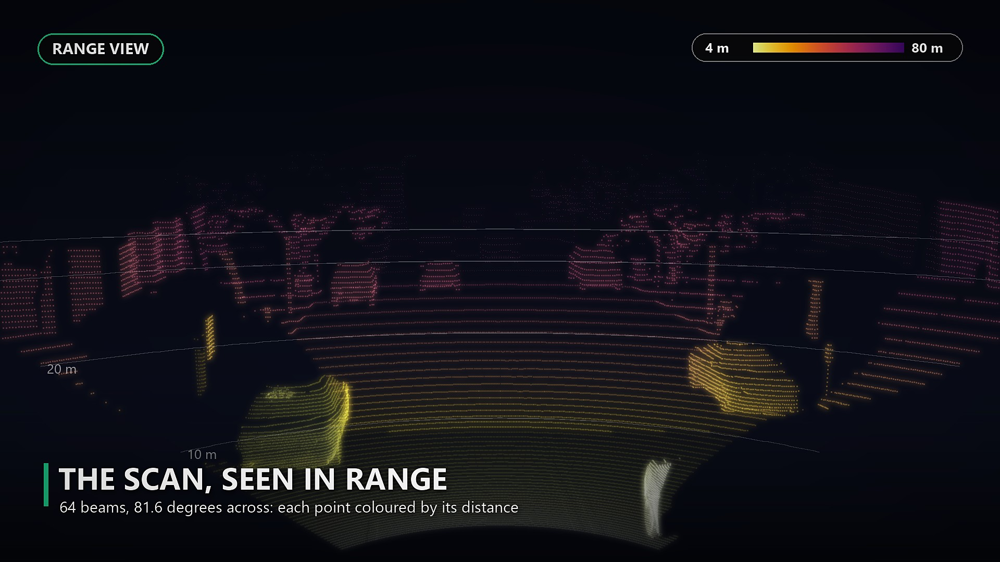

# VantageCV Remastered

### Synthetic AV Dataset Generator V2.0

[](https://github.com/evanpetersen919/VantageCV-V2/actions/workflows/lint_and_test.yml)

[](LICENSE)


**Procedural driving scenes, rendered in real Unreal Engine 5, with pixel-exact labels from the engine, a 64-beam
LiDAR matched to a real automotive sensor, and an open, honest research log of how well detectors trained on them
transfer to real data (BDD100K, Cityscapes, KITTI), including what didn't work.**


*Every annotation type on one vehicle, from a full 360 degree orbit (Rocketbox pedestrians): exact engine instance masks, 2D and 3D boxes, heading, class / distance / visibility tags and a live attribute card, then the Cityscapes class map and metric depth of the whole scene. All of it is the dataset's own labels, and it follows the object as the viewpoint changes.*

| **+4.7 AP** | **about 0.5 px** | **64 beams** | **1,200+ tests** |
|:---:|:---:|:---:|:---:|
| synthetic images added to 460 real BDD100K images ([results](#results)) | camera check: projected points against the engine's render | LiDAR scans in KITTI format with exact 3D boxes ([LiDAR](#lidar-new-in-20)) | strict mypy, pylint 10/10, CI on every push |

**Dataset:** [VantageCV Synthetic Driving: Riders on Kaggle](https://www.kaggle.com/datasets/evanpetersen919/vantagecv-synthetic-driving-riders): 1,399 frames with exact masks,
riders and bicycles, a class map and metric depth for every frame, with a
[quickstart notebook](https://www.kaggle.com/code/evanpetersen919/vantagecv-quickstart). Images and 2D labels
only (no LiDAR or 3D geometry; see [`LICENSING.md`](LICENSING.md)).

## What you get

| | |
|---|---|
| **Input** | A seed and a YAML scenario template. The same seed reproduces a frame exactly. |
| **Output** | COCO datasets (and a YOLO export) with 2D boxes, segmentation polygons, occlusion and truncation per object, and per-image condition metadata; KITTI-format camera labels and **LiDAR scans** (`velodyne/*.bin`, `label_2`, `calib`). |
| **Conditions** | Season, weather (clear, overcast, fog, rain, golden hour, sunset, dawn haze) and time of day, drawn per scenario from real conditions data. |
| **Scene** | Procedural road network, lanes, buildings, traffic (including articulated tractor-trailers), pedestrians and **cyclists** (riders on a parametric bicycle), built from City Sample assets and rendered live in UE5.4. |
| **Reliability** | A camera self-check runs before every dataset; a crashed render resumes where it stopped. |

## How it works



Jump to: [LiDAR](#lidar-new-in-20) · [Results](#results) · [Export formats](#export-formats) ·
[Roadmap](#roadmap) · [Quick start](#quick-start) · [Project layout](#project-layout) ·
[Contributing](CONTRIBUTING.md) · [Architecture](docs/architecture.rst) · [User guide](docs/user_guide.rst) ·
[Release notes](docs/release_notes.rst)

## What the generator produces


*Twelve frames from one generator: different seeds, layouts, seasons and conditions, with painted lane markings, signal heads that follow the phase and scanned street trees. Direct renders, with a mild contrast curve and vignette applied to all of them.*

|  |  |
|:---:|:---:|
| *A new city from a new seed every few seconds* | *Same street, same seed, same camera: day to night* |

Every object is placed and tracked as a real 3D box (center, dimensions, heading). That 3D geometry drives
occlusion ray-casting and 2D projection, and every generated frame's QA overlay draws it directly (yellow wireframe
below) alongside the exported 2D box (white) and segmentation silhouette (cyan), so the two stay honestly
checkable against each other:


Each COCO annotation carries the 2D box and segmentation polygon and a KITTI-convention `box3d` with the image's
`kitti_P2` projection matrix. Boxes are shrunk to the visible region for partially-occluded objects, matching
BDD100K and Cityscapes' own annotation convention (see [`EXPERIMENT_LOG.md`](EXPERIMENT_LOG.md)):


*One frame, one panel per annotation type: everything is exported with the image and comes from the engine and the scene, not from a model.*

Season, weather and time of day are drawn per scenario from real conditions data (`src/procedural/environment.py`),
so one dataset run spans a wide range of driving conditions. Below is the same street from the same camera, with only
the conditions changed:


*Columns are the four seasons, rows are clear day, rain and night. The layout, traffic and camera are identical in all twelve; the night row is brightened for the page.*

The street itself carries wet roads with reflections, realistic Rocketbox pedestrians (one crossing on the
crosswalk), golden hour, fog, night, fall colour and winter, over streets with MUTCD-dimensioned lane markings,
signal heads that follow their phase and scanned photographic trees and shrubs. Vegetation is 15.7% of pixels against
17.1% in real Cityscapes frames.


## LiDAR (new in 2.0)

Every rendered frame can also be turned into a LiDAR scan of the same scene. There is no separate simulation: the
engine's own metric depth is sampled along 64 beams, so the points, the camera image and the 3D boxes all describe
exactly the same geometry. The sensor is matched to the KITTI Velodyne's field of view and ring layout.


*How a scan is made: the engine's depth image is read along 64 beams (81.6 degrees wide, 0.18 degree steps, up to
80 m), and each return becomes a point. Colours are the engine's class map; boxes are the exact 3D labels.*



*The whole scan as a range picture: the nearest points are bright yellow, the far buildings fade to purple, and the 64 beam rings lie on the road. A KITTI-profile frame; there are no class colours or boxes here, only distance.*

| | |
|---|---|
| **Sensor** | 64 channels from -24.8 to +2.0 degrees, 81.6 degrees across (the KITTI camera field), 0.18 degree azimuth step, 80 m range, mounted at KITTI's camera height. |
| **Output** | KITTI object-detection layout: `velodyne/*.bin` (x y z intensity), `label_2`, `calib`, and a frame list. About 28,000 points per scan. |
| **Labels** | Exact 3D boxes from the scene in KITTI classes (Car, Pedestrian, Cyclist and the rest), with KITTI's conventions available as options (range cap, `Van` for long cars, pedestrian footprint). |
| **Optional realism** | Measured KITTI ring table, per-ring dropout, range noise and a minimum-returns rule (`configs/kitti_beam_pattern.json`), each off by default. |
| **Not included** | 360 degree coverage (a forward sector only, like the camera), intensity from material (it is 0 unless you ask for sampled values), multi-return and beam divergence. |

**Does synthetic LiDAR help a detector?** Not in the setup tested, and the log says so. A PointPillars detector
trained on 371 real KITTI scans plus 1,000 synthetic scans scored no better than the real scans alone
(mean 3D AP 66.0 against 66.3, five seeds), while 1,000 extra real scans gave 72.1. Three rounds of pre-registered
follow-up changed what is understood about why, not the headline:

- **Sensor and label realism changed nothing resolvable.** A measured ring table put 38% more points on pedestrians
  (median 98 to 135 at 10 to 20 m, KITTI 176), and dropout, noise and a minimum-returns rule were applied; none moved
  AP beyond noise at five seeds.
- **The real-only baseline was under-trained.** Training it for as many optimizer steps as the mixed arms raised it
  by 2.3 AP, which is the fair comparison for every synthetic arm.
- **A real/synthetic input flag helps a lot.** Giving the network a 0/1 domain feature recovered 9 to 15 pedestrian AP
  in the arms where it had been hurt, so the loss was the network being unable to tell the data apart.
- **Sampled intensity hurts, and pasted objects are neutral.** Drawing reflectance from KITTI histograms cost
  pedestrians 6 to 8 AP in each comparison tried (whole scenes and pasted objects alike); adding synthetic objects to the paste database of real scans was
  neutral (+0.3, not resolved).

Details, intervals and every arm are in experiments 39 to 42 of [`EXPERIMENT_LOG.md`](EXPERIMENT_LOG.md) and the
plan in [`docs/lidar/improvement_plan.md`](docs/lidar/improvement_plan.md).

## Results

A live-rendered synthetic dataset trains YOLOv10m detectors that are scored on real photos they have never seen.
[`EXPERIMENT_LOG.md`](EXPERIMENT_LOG.md) tracks every training run, what changed and the measured results, including
a Grad-CAM diagnosis, label-convention research and a rendering-pipeline audit: an honest research log, not a
highlight reel.

**Synthetic data helps at every real-data size tested, most when real data is scarce.** Added to 460 real BDD100K
images it raises AP by +4.7 (18.2 to 22.9); to 919, +3.3; to 1,838, +2.0 (optimizer held fixed; three seeds each,
p < 0.01 throughout). It is not a substitute: the same number of real images scores 2-3 AP higher, and roughly 3 to
7 synthetic images are worth one real one.


**What the experiments say**

- **Pedestrian count drives person AP.** 550 / 1,256 / about 2,000 persons in a 510-image supplement gave 14.8 /
  15.5 / 16.4 person AP.
- **Truck and bus AP did not respond to anything the generator controls.** Five levers were tested, each with its
  reading rule written first (vehicle mix, labelling, box sizes, input size, an added real box truck). Per box, small
  boxes are missed in every class and about 30% of medium and large trucks are called cars, at the same rate when
  training on real images only.
- **A larger input helps people and cars, not trucks.** At 1280 px instead of 960, person AP rises 1.6 and car AP 1.3.
- **MIT-licensed pedestrians keep the person gain.** With `pedestrian_source: rocketbox` (38 adult Microsoft
  Rocketbox avatars, 342 baked poses) in place of City Sample's crowd, person AP is 16.95 against 16.96, 99.8% of the
  +4.5 gain over real-only.
- **Synthetic cyclists help, but not as much as real ones (2.0).** On a registered study (5 seeds, 1,838-image real
  base), adding 1,000 synthetic rider-and-bicycle images raised the rider and bike mean AP from 8.0 to 12.9 (+4.9,
  positive in every seed). 1,000 real images of the same classes gave 19.2, so the synthetic ones supply about half
  the gain; repeat-factor sampling of the real base gave 9.8.
- **Synthetic LiDAR scans did not beat real ones (2.0).** See [LiDAR](#lidar-new-in-20) above.
- **Synthetic-only transfer is still far below real-data baselines.** Grad-CAM shows the detector keys on background
  texture like foliage and curbs rather than object shape.


The per-version history of the camera generator (v1 to v7), with every number, is in
[`EXPERIMENT_LOG.md`](EXPERIMENT_LOG.md).

## Export formats

A rendered dataset's `annotations.json` is COCO (2D boxes, polygons, occlusion and truncation). Forward-looking
frames also carry a `box3d` per object (a KITTI-convention 3D box in the level camera frame) and a `kitti_P2`
projection matrix per image. Scripts turn that into other layouts:

```bash
PYTHONPATH=. python bin/export_kitti.py --dataset live_dataset/NAME --out kitti_out --images copy   # camera: label_2, calib, image_2
PYTHONPATH=. python bin/export_masks.py --dataset live_dataset/NAME --out masks_out                 # instance, object-class PNGs
PYTHONPATH=. python bin/export_lidar_kitti.py --dataset live_dataset/NAME --out lidar_out           # LiDAR: velodyne, label_2, calib
```

The LiDAR export needs a dataset rendered with `--profile kitti --exact-labels --semantic-maps --classes riders` (the
template `configs/scenario_templates/urban_dense_v19_kitti.yaml` matches KITTI's pedestrian density). Its options
(`--range-cap`, `--van-rule`, `--pedestrian-footprint`, `--beam-table`, `--dropout`, `--range-noise`,
`--min-points`) are documented in `bin/export_lidar_kitti.py`.

With `--exact-labels` (about 1.5 s more per frame, game required) every vehicle and pedestrian box, visible fraction
and mask comes from what the game itself renders instead of from proxy shapes: an object's pixels are where its own
depth equals the scene's depth. Those annotations carry a `mask_rle` (COCO run-length) and a polygon traced from it
pixel edge by pixel edge (IoU 0.997 with the mask for persons). `bin/audit_labels.py` measures the geometric labels
against the game's render: full boxes of vehicles score 0.94 to 0.99 IoU, pedestrians 0.79.

With `--semantic-maps` each frame also gets a **full-scene class map** (`semantic/<frame>.png`, Cityscapes label ids)
and a **depth map** (`depth/<frame>.png`, 16-bit, metres x 256 along the viewing axis), both from the engine's own
depth passes. On the probe frames the class map agreed with 100% of the instance-mask pixels of cars, persons and
trucks, and depth agreed with independent 3D boxes for 95% of unoccluded vehicles. `bin/package_dataset.py` builds a
self-contained release folder (COCO, YOLO detection and segmentation labels, KITTI, instance masks, class table,
dataset card) and validates it.

## Roadmap

The plan, with what each step is meant to answer and what is deliberately not being done, is in
[`ROADMAP.md`](ROADMAP.md). Where things stand after 2.0:

- **Dataset:** published on [Kaggle](https://www.kaggle.com/datasets/evanpetersen919/vantagecv-synthetic-driving-riders) (2026-10-13): 1,399 Rocketbox-batch frames with exact masks, riders, class
  maps and depth, images and 2D labels only. The LiDAR scans and 3D labels are not released until the point-cloud
  licensing question in [`LICENSING.md`](LICENSING.md) is answered; no trained weights will be published.
- **LiDAR transfer:** open. The remaining untried step is object insertion that protects real labelled objects from
  the shadow step (experiment 42); 360 degree coverage with multi-camera RGB is planned as a separate release.
- **Closed loop:** vehicle physics and traffic belong to CARLA (`carla_loop/`); VantageCV stays static and labelled.
- **Statistics:** the per-scan bootstrap for the LiDAR and cyclist studies still needs the detections saved by the
  cluster jobs.

New here? See [`CONTRIBUTING.md`](CONTRIBUTING.md).

## Quick start

**Requirements**

- Python 3.11.8
- [Poetry](https://python-poetry.org/) 1.7.1
- Unreal Engine 5.4 LTS, with a City Sample-based project: required for `bin/generate_live_dataset.py` (the real
  rendering path) and for building `unreal_plugin/SyntheticDataGen/`.

**Setup**

```bash
poetry install
poetry run pytest --cov=src tests/
```

If `poetry run pytest` doesn't pick up a module you just added, run `poetry install` again first; see
`KNOWN_GAPS_AND_ISSUES.md`.

**Generate a dataset**

Requires a running UE5 game session with the plugin loaded (see `unreal_plugin/SyntheticDataGen/`), reachable over
the WebSocket RPC bridge. Launch it with `bin/launch_ue5.ps1` rather than starting `UnrealEditor.exe` by hand: it
strips the `ELECTRON_RUN_AS_NODE` environment variable (which silently breaks the editor if inherited from a VS Code
process tree) and pins the render resolution to 1920x1080:

```powershell
powershell -File bin/launch_ue5.ps1
```

```bash
python bin/generate_live_dataset.py \
    --config configs/scenario_templates/urban_dense.yaml \
    --num-scenarios 20 \
    --seed 0 \
    --out ./live_dataset/my_run
```

A KITTI-profile run for LiDAR export:

```bash
python bin/generate_live_dataset.py \
    --config configs/scenario_templates/urban_dense_v19_kitti.yaml \
    --profile kitti --exact-labels --semantic-maps --classes riders \
    --num-scenarios 20 --seed 0 --out ./live_dataset/kitti_run
PYTHONPATH=. python bin/export_lidar_kitti.py --dataset live_dataset/kitti_run --out ./lidar_out --range-cap --van-rule
```

The generator runs a camera self-check against four known ground squares before rendering anything, and resumes
cleanly if the game crashes mid-run (rerun the same command). See [`EXPERIMENT_LOG.md`](EXPERIMENT_LOG.md) for how
this path is used end-to-end (dataset generation, detector training, real-benchmark evaluation), and
[`docs/user_guide.rst`](docs/user_guide.rst) for more.

**See a LiDAR scan**

```bash
PYTHONPATH=. python bin/visualize_lidar_scan.py --dataset live_dataset/kitti_run --frame 12 --pattern kitti --out lidar_viz
PYTHONPATH=. python bin/render_lidar_explainer.py --dataset live_dataset/kitti_run --frame 12 --out lidar_how_it_works.gif   # the animation above
PYTHONPATH=. python bin/render_lidar_range_still.py --dataset live_dataset/kitti_run --frame 12 --out lidar_range_view.jpg  # the range picture
```

<details>
<summary><b>Building the docs</b></summary>

```bash
poetry run sphinx-build -b html docs docs/_build/html
```

</details>

## Project layout

**Library (`src/`)**

- `src/procedural/` -- road network, lane topology, building placement, traffic, mesh generation
- `src/sensors/` -- camera model and the depth-sampled LiDAR (`depth_lidar.py`, `lidar_realism.py`, `shadow.py`)
- `src/ground_truth/` -- bbox, segmentation and depth-map extraction
- `src/export/` -- COCO, KITTI and LiDAR exporters, object databases, metadata aggregation
- `src/validation/` -- dataset sanity checks
- `src/orchestration/` -- end-to-end pipeline, Ray-based parallel generation, resumable generation
- `src/evaluation/` -- real-benchmark loaders (BDD100K, Cityscapes), scoring, KITTI result parsing, paired statistics, dataset splits
- `src/ue5/` -- JSON-RPC/WebSocket client for UE5, driving a live game session
- `unreal_plugin/SyntheticDataGen/` -- UE5 C++ plugin: scenario loading, mesh spawning, night lights, RPC server
- `configs/` -- scenario and sensor YAML templates, KITTI-derived constants and splits
- `hpc/` -- Slurm scripts for the camera and LiDAR studies (`hpc/lidar/` has the OpenPCDet setup and the arms)

**Command-line tools (`bin/`)**

- Generate: `generate_live_dataset.py` (real UE5 rendering) and `generate_dataset.py` (offline, no game);
  `launch_ue5.ps1` starts the game session
- Export: `export_kitti.py`, `export_masks.py`, `export_lidar_kitti.py`, `package_dataset.py`
- Prepare: `split_dataset.py`, `export_yolo.py`, `audit_dataset.py`, `prepare_lidar_arms.py`
- Train and score: `train_detector.py`, `evaluate_detector.py`, `analyze_lidar_followup.py`, `analyze_rider_study.py`
- Diagnose: `gradcam_compare.py`, `audit_lidar_domain_gap.py`, `derive_beam_pattern.py`
- Visualise: `visualize_lidar_scan.py`, `render_lidar_explainer.py`, `render_lidar_range_still.py`
- Measure the real statistics the generator is fit to: the `measure_*.py` and `fit_*.py` scripts

**Project records**

- `EXPERIMENT_LOG.md` -- every training run: what changed, why, and the measured results
- `KNOWN_GAPS_AND_ISSUES.md` -- every deliberate scope decision and bug found along the way
- `docs/` -- Sphinx documentation source, release notes, pre-registrations (`docs/riders/`, `docs/lidar/`);
  `tests/` -- unit and integration test suites
- `CONTRIBUTING.md` -- how to help; `CITATION.cff` -- how to cite

## License and credits

The code is released under the [MIT license](LICENSE). The rendered images and videos in this repository were made
with Epic Games' City Sample content in Unreal Engine; under Epic's Content License Agreement (section 3b, linear
media), rendered images and video created with the licensed content may be distributed. No Epic asset files, and no
geometry extracted from them, are included in this repository; the vehicle meshes used for occlusion tests are
generated locally from your own copy of City Sample (`bin/dump_vehicle_meshes.py`), and those tests are skipped where
the file is absent.

Unreal Engine and City Sample are the property of Epic Games, Inc.

**Licensing record.** What each asset class comes from, the clauses read, and what is still open are in
[`LICENSING.md`](LICENSING.md).

**Status of the pedestrian assets.** Whether City Sample's crowd characters (adapted from Epic's MetaHumans) may be
used to train models is not settled: Epic was asked (2026-10-05) and replied (2026-10-08) that it cannot give legal
or EULA interpretations for a specific distribution model and recommended the developer's own legal counsel. New
work uses the MIT-licensed Rocketbox avatars instead, and the City Sample crowd is kept only to reproduce earlier
batches. One dataset is published (the Rocketbox-batch, images-only set on Kaggle above); no trained weights are
published, and results that rely on synthetic pedestrians are provisional.
